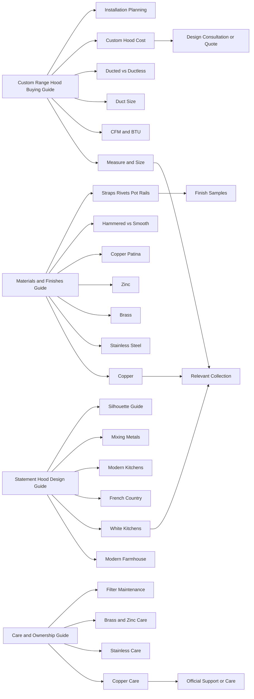

# ERH Blog 内容模型与内链蓝图

## 1. 结论先行

ERH 当前最需要的不是继续零散写“某种 hood 很漂亮”，而是建立一套能回答购买全过程的主题系统：

`发现灵感 → 理解材料 → 计算尺寸与通风 → 比较配置与成本 → 准备安装 → 正确保养 → 查看真实案例 → 咨询/购买`

竞品素材证明，稳定获得流量和转化的页面通常同时具备：

- 一个明确搜索问题，而不是多个意图混在一起。
- 开头直接给答案。
- 表格、公式、步骤、对比图或决策矩阵等可操作信息。
- 产品、支持页和相邻文章之间的上下文内链。
- FAQ 覆盖自然的后续问题。
- 真实作者/审校者、来源、更新时间和专业风险提示。
- 与品牌真实产品、工艺或案例连接的独特证据。

## 2. ERH 现状诊断

### 已有优势

- 产品横跨 copper、stainless steel、brass、zinc，天然适合材料主题集群。
- 造型、finish、straps、rivets、mount 和定制尺寸提供大量真实决策内容。
- 现有文章已经尝试尺寸、材料、趋势、历史和细节主题。
- 站点有 collection、samples、contact、buying guides、maintenance 等潜在转化落点。
- 2026 年的新文章开始使用 before/after、project story 和材料协调角度，方向正确。

### 主要缺口

- 现有代表文章普遍偏短，技术证据、来源、FAQ、对比表和实际案例不足。
- 作者显示为 `My Store Admin`，不利于建立工艺与技术可信度。
- tag 命名混乱：完整标题、大小写、下划线、宽泛关键词和材料标签并存。
- 已有文章中的 clearance 等数字缺少 product/manual 条件，且与外部来源冲突。
- 文章到 collection/product/support 的内链密度和锚文本策略不稳定。
- 缺少一篇真正的 custom range hood buying guide 统领全部支持内容。
- 缺少 CFM、duct size、ducted vs ductless、cost、sloped ceiling、island、care by finish 等高意向内容。
- 风格文章多用泛化描述，尚未充分利用 ERH 自有项目图、finish 样品和产品系列。

## 3. 推荐信息架构

### Pillar A：Custom Range Hood Buying Guide

主问题：如何选择适合厨房、烹饪方式、预算和审美的 custom range hood？

支持内容：

- How to measure a custom range hood。
- Range hood width, height and depth。
- CFM and BTU guide。
- Duct size guide。
- Ducted vs ductless。
- Wall-mount vs island vs under-cabinet。
- Custom range hood cost。
- Installation planning checklist。
- Sloped/vaulted ceiling solutions。

主要转化：range hood collections、design consultation、samples、contact。

### Pillar B：Range Hood Materials & Finishes

主问题：copper、stainless steel、brass、zinc 应该如何选？

支持内容：

- Copper vs brass vs stainless steel vs zinc。
- Copper patina guide。
- Stainless steel grade/finish guide；只写 ERH 已确认牌号。
- Brass finish and aging guide。
- Zinc appearance and care guide。
- Hammered vs smooth texture。
- Matte, brushed, polished, antique, oil-rubbed 等 finish 对比；名称以 ERH 样品为准。
- Straps, rivets, pot rails and trim。
- How to mix metals in a kitchen。

主要转化：材料 collections、finish samples、custom design。

### Pillar C：Kitchen Design with a Statement Hood

主问题：如何把 range hood 设计成与厨房比例、颜色和风格协调的焦点？

支持内容：

- Modern kitchen。
- Modern farmhouse。
- French country。
- White kitchen。
- Industrial kitchen。
- Transitional kitchen。
- Dark cabinetry / blue / green / natural wood 搭配。
- Copper color pairings。
- Mixing metals。
- Hood silhouette guide。
- High-ceiling、island、small kitchen、open-plan 场景。

主要转化：风格对应 collection、gallery、case studies、samples。

### Pillar D：Care, Maintenance & Ownership

主问题：如何让 ERH hood 长期保持性能和外观？

支持内容：

- Finish identification before cleaning。
- Copper hood care by natural/patinated/sealed finish。
- Stainless steel hood cleaning。
- Brass and zinc care。
- Grease filter cleaning/replacement。
- Patina changes: expected vs damage。
- Troubleshooting airflow/noise；只做用户级检查。
- When to contact support or a professional。

主要转化：official care pages、replacement/support、contact。

### Pillar E：Projects, Craft & Proof

主问题：ERH 如何解决真实厨房中的比例、材料和安装限制？

支持内容：

- Before/after project stories。
- Designer collaboration。
- Sloped ceiling case。
- Island focal-point case。
- White kitchen + contrasting hood。
- Copper patina/finish selection case。
- From sketch/sample to finished hood。
- Hammering、welding、straps/rivets 的真实制作过程。

主要转化：同款/近似产品、gallery、quote/design consultation。

## 4. 内容原型的页面组件

### 4.1 技术指南组件

1. 40–70 词 direct answer。
2. “At a glance” 表格或公式。
3. 变量解释：cooktop、BTU、mount、width、ceiling、duct、blower。
4. 分场景建议。
5. 测量或决策步骤。
6. 常见错误与后果。
7. “Check your manual/local code” 提示。
8. FAQ。
9. 设计咨询 CTA。

### 4.2 材料/finish 对比组件

1. 一句话推荐规则。
2. 对比表：appearance、aging、maintenance、style、best for。
3. 每种材料的优点与限制。
4. 与 cabinetry/countertop/hardware 的搭配。
5. 真实 finish sample 或项目图。
6. 如何选择与下一步样品 CTA。

### 4.3 风格指南组件

1. 风格定义和视觉目标。
2. palette、cabinetry、countertops、backsplash、lighting。
3. hood silhouette、material、finish、straps/rivets 的角色。
4. 3–7 个可执行组合。
5. “Avoid these mistakes”。
6. 项目图/产品图和 alt。
7. 对应 collection/gallery CTA。

### 4.4 成本/购买组件

1. 直接回答“价格为什么变化”。
2. 价格驱动变量，而不是无来源的宽泛报价。
3. base configuration 与 upgrade categories。
4. 安装、ductwork、electrical、makeup air 等非产品成本。
5. budget trade-offs。
6. quote 准备清单。
7. request design/quote CTA。

### 4.5 案例组件

1. Hero image + 项目摘要。
2. 客户/设计挑战。
3. 约束：尺寸、ceiling、cooktop、duct、palette。
4. 为什么选择该 silhouette/material/finish/details。
5. 制作与确认过程。
6. 安装结果和实际体验；只写有证据的结果。
7. 可迁移的设计经验。
8. 同类产品/咨询 CTA。

## 5. 关键词与意图边界

以下是内容语义，不代表实时搜索量；正式立项时再做当前 SERP/关键词验证。

| 页面家族 | 主意图 | 示例核心词 | 不应与其争夺的页面 |
|---|---|---|---|
| Collection | 购买/浏览 | custom copper range hoods | 文章只解释与比较，不以完全相同 title 充当商品列表 |
| Buying guide | 综合决策 | how to choose a custom range hood | 单一问题文章链接回 guide，不重复所有章节 |
| Measurement | 操作 | how to measure for a custom range hood | clearance、CFM 和 duct 只做必要摘要并链接专页 |
| Clearance | 技术答案 | range hood height above stove | 不再同时创建 `best height`、`distance over cooktop` 多个近义页 |
| CFM | 技术计算 | how many CFM for a range hood | 与 duct size 分开，但互相链接 |
| Duct size | 技术规格 | range hood duct size | 不写成 ducted vs ductless 的重复定义页 |
| Ducted comparison | 方案决策 | ducted vs ductless range hood | 合并 `vented vs non-vented`、`are ductless effective` 等近义意图 |
| Cost | 价格决策 | custom range hood cost | 实时产品价留给商品/报价系统 |
| Material comparison | 材料决策 | copper vs brass range hood | 单材料页深入特性，比较页负责选择 |
| Patina | 材料/保养 | copper patina guide | 清洁页只按 finish 链接回 patina pillar |
| Style | 灵感 | copper range hood in white kitchen | 产品页保持交易意图，文章负责完整空间搭配 |

### 蚕食处理规则

- 两个页面若主问题、主关键词和 SERP 类型基本相同，优先合并。
- 旧页有链接或排名时，更新旧 URL；不要仅因标题不完美就新建。
- 需要合并时，保留更强 canonical URL，并规划 301；实际重定向必须用户授权后执行。
- 支持文章只回答一个明确子问题，并在开头链接 pillar。
- 趋势年份页必须指定下一次更新时间；否则写 evergreen 标题。

## 6. 内链蓝图

### 6.1 Hub-and-spoke 关系



这些节点是内容角色，不代表已经存在的线上 URL。添加实际链接前必须读取当前 sitemap/Shopify 资源并核验 handle。

### 6.2 单篇文章链接配方

对 1,200–2,000 词文章，通常建议：

- 1 个 pillar/hub 链接。
- 2–3 个 supporting article 链接。
- 1 个 collection 或产品族链接。
- 1 个 samples、gallery、contact、care 或 installation 真源链接。
- 0–3 个外部权威来源，根据技术密度决定。

不要机械追求链接数量。每个链接必须回答读者在该句产生的下一问题。

### 6.3 锚文本规则

优先：

- `calculate the right range hood width`
- `compare copper and brass finishes`
- `review the official installation guide`
- `explore custom copper range hoods`

避免：

- `click here`
- 连续多次完全匹配 `custom range hood`
- 用产品名链接到无关 blog，或用信息锚文本链接到购物车。

### 6.4 反向补链

每个新稿必须给出一个 back-link plan：

| 来源旧页 | 建议锚文本 | 新页插入位置 | 理由 |
|---|---|---|---|
| 已有 measurement 文章 | `choose the right duct size` | width/depth 后 | 从尺寸进入 airflow 规划 |
| 已有 copper design 文章 | `understand how copper patina develops` | finish 段 | 从审美进入材料教育 |
| 已有 straps/rivets 文章 | `compare available metal finishes` | finish/width 段 | 从细节进入 samples/finish guide |

表中的实际来源 URL 和新 URL 必须在每个项目中替换为已核验路径。

## 7. 可信度与来源模型

### 作者/审校信息

不要继续使用 `My Store Admin` 作为公开作者。如果组织允许，建立真实署名体系：

- Design Team：风格、色彩、项目文章。
- Product Specialist：材料、定制和产品选择。
- Technical Reviewer / Installation Partner：CFM、duct、clearance、安装规划。
- Editorial Team：宽泛灵感内容，但仍注明事实审校者。

只有真实存在且同意公开的人/团队才可使用。

### 技术来源优先级

1. ERH 当前产品 manual/liner specifications。
2. 当地 building/mechanical code 官方页面。
3. EPA、CDC、DOE、NIST 等政府机构。
4. 同行评审论文和标准组织。
5. 设备制造商官方说明。
6. 竞品文章只能提示需要验证的议题。

### 典型冲突处理

- **Clearance 冲突**：写“recommended clearance varies by cooktop, hood/liner model and code”，然后引用具体 ERH manual；不要综合平均多个竞品数字。
- **CFM 冲突**：先说明计算方法和影响变量，再用 ERH 实际 blower 选项映射；不可承诺越高越好。
- **Copper care 冲突**：先识别 finish；natural copper 的处理不能用于 lacquered/patinated 成品。
- **Antimicrobial 冲突**：只描述满足研究条件的 bare copper evidence，不把它变成 ERH 产品健康功效。
- **价格冲突**：解释 ERH 报价变量；竞争对手价格仅用于内部市场研究。

## 8. 视觉与图片模型

每篇文章在 brief 阶段写 image plan：

- Hero：展示文章最终收益，不只是孤立产品白底图。
- Technical diagram：尺寸、clearance、duct path、airflow 或组件关系。
- Comparison：两到四个 finish/material/silhouette 的一致视角对照。
- Context image：把 hood 放在完整厨房中，能看出 cabinetry、ceiling 和 island 比例。
- Detail image：straps、rivets、hammering、seam、finish 纹理。
- CTA image：真实 samples、design consultation 或相关 collection。

Alt text 写画面事实，例如：

`Hand-hammered copper wall-mount range hood above a 48-inch gas range in a white oak kitchen.`

不要写：

`best custom copper range hood luxury kitchen hood custom vent hood`。

图片版权、授权和产品归属必须可追溯；不能下载竞品图片用于 ERH 稿件。

## 9. 优先内容路线图

### P0：先修基础与高意向页面

1. 审计并升级现有 measurement 文章，补 manual 条件、图、FAQ 与内链。
2. 建立 Custom Range Hood Buying Guide pillar。
3. 建立 CFM/BTU guide。
4. 建立 Duct Size guide。
5. 建立 Ducted vs Ductless 决策页。
6. 建立 Custom Range Hood Cost guide，使用 ERH 自有报价逻辑。
7. 建立 Installation Planning Checklist，把具体安装交给 official manual。
8. 建立 Materials & Finishes pillar。

### P1：形成材料与设计壁垒

9. Copper Patina Guide by Finish。
10. Copper vs Brass vs Stainless Steel vs Zinc。
11. Hammered vs Smooth Metal Finish。
12. Straps, Rivets and Pot Rails Guide；可升级现有文章。
13. Range Hood Silhouette Guide。
14. Sloped/Vaulted Ceiling Case and Guide。
15. Island Range Hood Planning Guide。
16. White Kitchen Hood Pairing Guide。
17. Modern Farmhouse Hood Guide。
18. Mixing Metals Around a Statement Hood。

### P2：用真实证据提高转化

19. From Sketch and Sample to Finished Hood。
20. Before/After project series。
21. Designer interview series。
22. ERH craftsmanship process。
23. Copper/stainless/brass/zinc care by approved finish。
24. Filter maintenance and ownership calendar。

## 10. 单篇立项 Brief 模板

```markdown
# Content Brief

- Topic:
- Primary keyword:
- Search intent:
- Audience:
- Cluster / pillar:
- Funnel stage:
- Existing-page cannibalization check:
- Target collection/product/support page:
- Direct answer:
- Unique ERH evidence:
- Facts requiring verification:
- Primary sources:
- H2/H3 outline:
- Comparison/table/diagram:
- Image plan:
- Internal links out:
- Back-links from existing pages:
- CTA:
- Update/review date:
```

## 11. Shopify 输出与自动化接口

### 内容对象建议字段

```yaml
title: ""
handle: ""
author: ""
blog_handle: "news"
tags: []
summary_html: ""
body_html: ""
seo_title: ""
seo_description: ""
featured_image:
  source: ""
  alt: ""
status: "draft"
publish_at: null
sources: []
internal_links: []
backlink_tasks: []
```

`status` 必须默认是 `draft`。任何未来 Shopify 脚本都应把“生成 payload”“创建草稿”“发布”拆成三个独立动作。

### 发布前自动检查

- handle 是否与现有 article 冲突。
- title、meta 长度是否合理。
- body 是否含重复 H1、script、Liquid 或无效 HTML。
- 所有内部链接是否返回有效页面并指向 canonical。
- 图片是否有 alt 和授权来源。
- 是否存在孤儿页和至少两个 back-link tasks。
- 是否有未经核验的价格、年份、clearance、CFM、duct、warranty 等高风险字段。
- 是否仍为 draft；只有显式参数才允许发布。

## 12. 封装 Skill 时的资源拆分

内容测试稳定后，按以下方式迁移，避免把所有资料塞入 `SKILL.md`：

```text
generate-erh-shopify-blog/
├── SKILL.md
├── agents/
│   └── openai.yaml
├── references/
│   ├── brand-and-product-facts.md
│   ├── content-model.md
│   ├── source-audit.md
│   ├── internal-link-inventory.md
│   └── shopify-format.md
├── scripts/
│   ├── check_cannibalization.*
│   ├── validate_links.*
│   ├── lint_article_html.*
│   ├── build_shopify_payload.*
│   └── create_shopify_draft.*
└── assets/
    └── shopify-blog-draft.md
```

`SKILL.md` 只保留：触发语境、输入要求、主流程、按需读取哪些 reference、工具调用次序、draft/publish 边界和最终 QA。详细研究、URL 清单、品牌事实和格式模板都放 references/assets。
